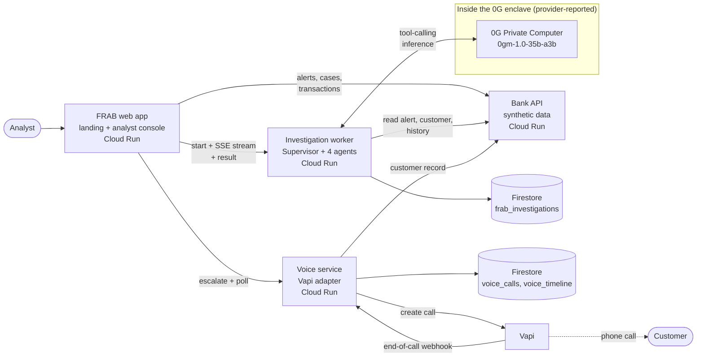
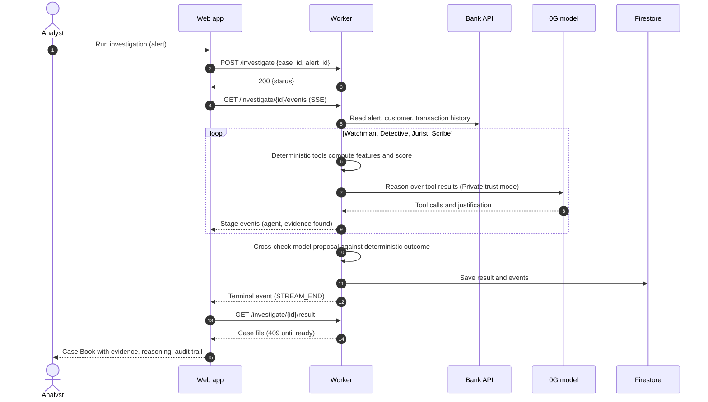
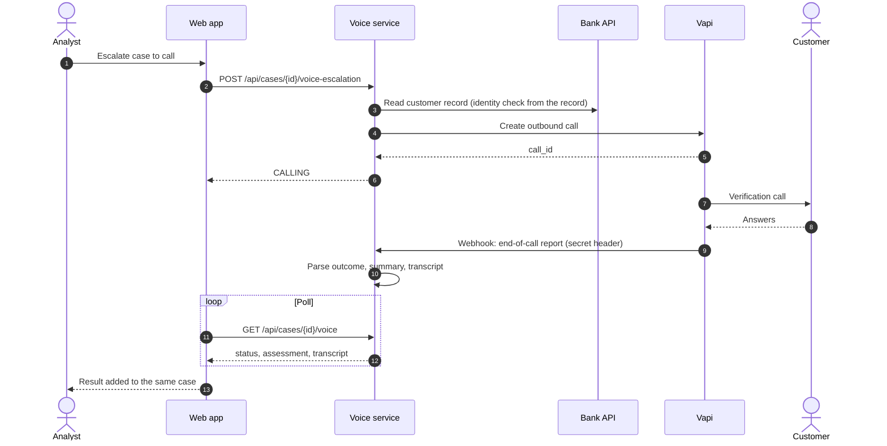

# FRAB: Fraud Response & Autonomous Backbone

> **Moving Financial Security from Reactive Protection to Proactive Prevention.**
>
> Don't make customers the first line of fraud detection. Make the financial system their first line of protection.

FRAB is an investigation layer that sits on top of a bank's existing fraud alerts. When a transaction is flagged, a Supervisor and four specialist agents gather evidence, trace the money, map findings to AML context and return an evidence-linked recommendation. An analyst can escalate to a verification call with the customer. **A human always makes the final decision.**

All data is synthetic. This is a prototype, not a production system.

---

## At a glance

| | |
| --- | --- |
| **Problem** | Fraud alerts arrive without a story. Analysts rebuild context by hand while the customer is the first to notice. |
| **Approach** | Deterministic tools measure (risk score, baseline deviation, beneficiary network). A language model reasons over those results and explains them. It never supplies the numbers. |
| **Output** | Risk level, recommendation (`CLOSE`, `MONITOR`, `ESCALATE`, `BLOCK`, `INSUFFICIENT_EVIDENCE`), evidence list with IDs, reasoning chain, audit timeline. |
| **Inference** | 0G Private Computer in `Private` trust mode, model `0gm-1.0-35b-a3b`. |
| **Stack** | React 19, TanStack Start, three.js on the web. Python, FastAPI on the services. Cloud Run, Firestore, Vapi. |

## Architecture



Only the model call runs inside the 0G enclave, as reported by the provider. The web app, worker, voice service, Firestore and the bank API sit outside it. FRAB does not yet verify the enclave attestation itself.

## Investigation flow



## Voice escalation flow



The expected answer to the identity question is built by the voice service from the bank's customer record. It never reaches the browser.

## The agents

| Agent | Role |
| --- | --- |
| **Supervisor** | Runs the workflow, tracks case state, keeps a result when a stage fails (`PARTIAL`, `FAILED`). |
| **Watchman** | Scores the trigger transaction against the customer's own baseline, computed with the trigger removed. |
| **Detective** | Queries history and traces the beneficiary network (for example `MULE_COLLECTION`, `STRUCTURING`). |
| **Jurist** | Adds AML and regulatory context with evidence references. |
| **Scribe** | Compiles the report and recommendation. |
| **Call Escalation** | Optional customer verification by voice, started by the analyst. |

## Integrity guarantees

- **Numbers come from code.** Every score and conclusion traces to a deterministic computation or an evidence ID. The model is never the source of truth.
- **Model disagreement is shown, not hidden.** The shipped action is the deterministic one. If the model proposes something else, the case file records the disagreement for the analyst.
- **No answer-key leakage.** The dataset's expected outcomes are used only as test oracles, never as investigation input.
- **Fallbacks are labelled.** A fallback step is never presented as the model's opinion. Provider failures surface as an `LLM_ERROR` event and a visible error block.
- **Honest status in the UI.** Inference badges follow the worker's real `/health` (`0g`, `0g-mock`, `offline`). Attestation is shown as not verified by FRAB.

## Reference runs

Recorded on the deployed worker with real 0G inference. One run takes about 20 to 30 seconds and costs under $0.002.

| Alert | Pattern | Risk | Final action | Model proposal |
| --- | --- | --- | --- | --- |
| ALT0001 | High-value new beneficiary | 0.55 HIGH | ESCALATE | ESCALATE |
| ALT0003 | Structuring | 0.13 HIGH | ESCALATE | ESCALATE |
| ALT0007 | Mule collection | 0.61 HIGH | ESCALATE | ESCALATE |
| ALT0005 | New beneficiary | 0.23 MEDIUM | MONITOR | ESCALATE (disagrees) |
| ALT0010 | High-value transfer | 0.14 LOW | CLOSE | ESCALATE (disagrees) |

## Repository layout

```text
src/                     Web app (landing page + analyst console)
├── routes/              File-based routes
├── components/frab/     Landing page: hero scene, story acts
├── components/app/      Console: overview, alerts, workspace, case book
├── hooks/               Investigation run, voice escalation, ledger, health
└── lib/                 Clients and adapters: bank, worker, voice
frab-worker/             Investigation worker (FastAPI): agents, tools, 0G client
frab-voice/              Voice escalation service (FastAPI): Vapi adapter
FRAB_DEMO_READY_DATASET/ Synthetic bank data (CSV)
```

## Run it

**Prerequisites:** Node.js 22 and npm.

```bash
npm install
cp .env.example .env     # fill in the values below
npm run dev              # http://localhost:8080
```

| Variable | Purpose |
| --- | --- |
| `VITE_FRAB_API_URL` | Bank API base URL. Unset gives a labelled simulated feed. |
| `VITE_FRAB_WORKER_URL` | Investigation worker base URL. |
| `VITE_FRAB_WORKER_TOKEN` | Token for `/investigate*` (sent as `?token=`). |
| `VITE_FRAB_VOICE_URL` | Voice service base URL. |
| `VITE_FRAB_VOICE_TOKEN` | Token for the voice service (sent as `Authorization: Bearer`). |

`VITE_*` values are compiled into the browser bundle. The two tokens deter casual abuse but are not secrets. A server-side proxy would be the real fix.

Without a worker or voice URL, those screens show a clear "not connected" state. To run the backends locally, see [`frab-worker/README.md`](./frab-worker/README.md) and [`frab-voice/README.md`](./frab-voice/README.md).

## Deploy

The web app builds to a Node server and ships as a container on Cloud Run.

```bash
gcloud builds submit --config cloudbuild.yaml \
  --substitutions=_WORKER_TOKEN="$WORKER_TOKEN",_VOICE_TOKEN="$VOICE_TOKEN"
```

Each backend allows only the frontend origins it is configured with, so a new frontend URL must be added to the worker and voice CORS lists. Full steps: [`DEPLOY_CLOUDRUN.md`](./DEPLOY_CLOUDRUN.md), [`frab-worker/DEPLOY.md`](./frab-worker/DEPLOY.md), [`frab-voice/DEPLOY.md`](./frab-voice/DEPLOY.md).

## Capability status

| Capability | Status |
| --- | --- |
| Synthetic bank data, alert queue, bank API | Implemented |
| Supervisor and four agents with deterministic tools | Implemented |
| Inference on 0G Private Computer (Private trust mode) | Implemented |
| Evidence-backed case reports, live event stream | Implemented |
| Voice escalation with identity check | Implemented |
| Cloud Run services, Firestore case storage | Implemented |
| Enclave attestation verified by FRAB | Planned |
| Case status write-back to the bank | Planned (bank API is read-only) |

## Limitations

- Synthetic, fixed dataset. The bank's live feed errors, so the console polls.
- Only the model call is inside the 0G enclave. Everything else runs outside it.
- Tokens in the browser bundle are a deterrent, not user authentication.
- Analyst decisions in the console are not written back to the bank.

## Contracts

- Worker: [`frab-worker/CONTRACT.md`](./frab-worker/CONTRACT.md), [`frab-worker/CONTRACT_DIFF.md`](./frab-worker/CONTRACT_DIFF.md)
- Voice: [`frab-voice/CONTRACT.md`](./frab-voice/CONTRACT.md)

## License

MIT. See [`LICENSE`](./LICENSE).
